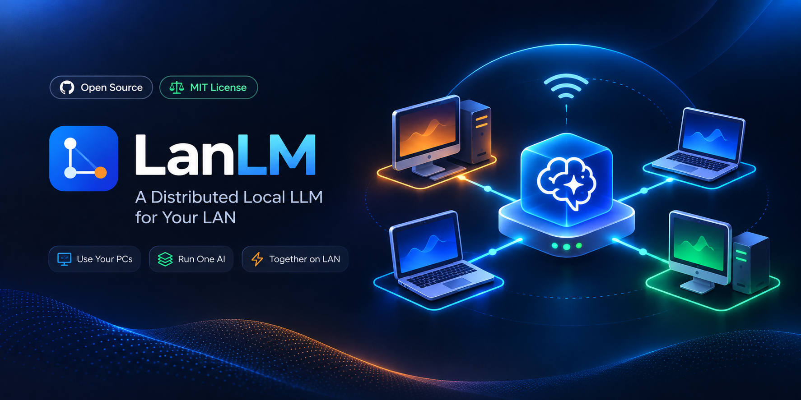
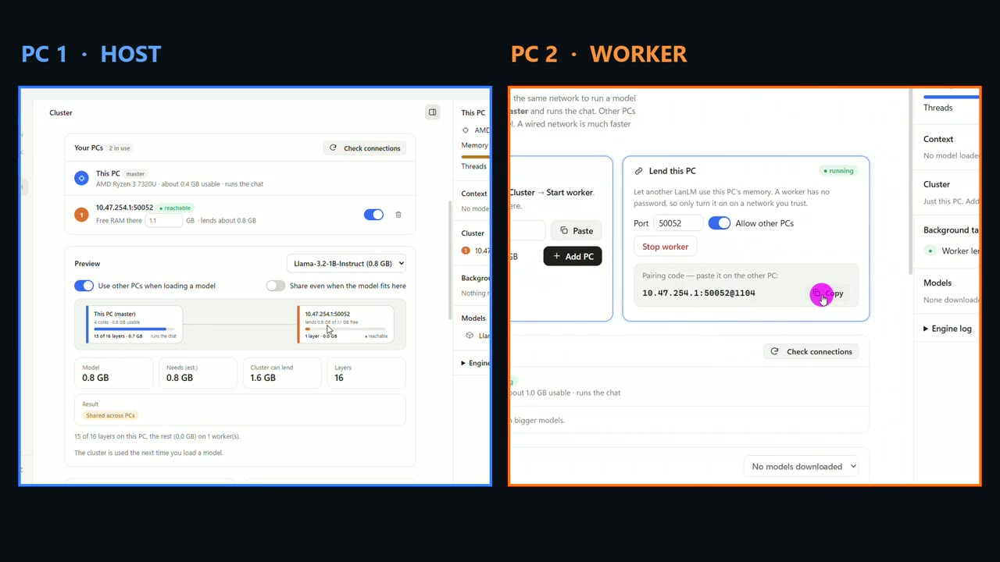

<div align="center">



# LanLM

**Run local LLMs on your PC — or pool several PCs to run models too big for one.**
A free, open-source Windows desktop app for [llama.cpp](https://github.com/ggml-org/llama.cpp) and GGUF models.
Private by design: no account, no cloud, no telemetry.

[](https://github.com/sakthiveltofficial/lanlm/actions/workflows/ci.yml)
[](https://github.com/sakthiveltofficial/lanlm/releases)
[](LICENSE)


[](CONTRIBUTING.md)

[Download](https://github.com/sakthiveltofficial/lanlm/releases) · [Features](#features) · [Cluster](#cluster-run-bigger-models-across-several-pcs) · [Local API](#local-openai-compatible-api) · [Build from source](#build-from-source) · [Contributing](CONTRIBUTING.md) · [FAQ](#faq)

</div>

---
## Demo

<div align="center">

[](docs/demo/lanlm-demo.mp4)

**[▶ Watch the full demo](docs/demo/lanlm-demo.mp4)** (1 min 47 s): download, engine setup, loading a model, chatting, linking a second PC, the model catalog and settings.

</div>


**LanLM** is a desktop app that runs open large language models (LLMs) **offline on your own computer**, using the proven [llama.cpp](https://github.com/ggml-org/llama.cpp) engine. Download a model once, chat with it privately, and expose it to other tools through an OpenAI-compatible local API.

Its standout feature is the **cluster**: link a second (or third) PC on your network, and LanLM splits a model's layers across them, so you can run a model that does not fit in one machine's RAM. A visual preview shows exactly which layers land on which PC _before_ you load anything.

## Features

- **Run any GGUF model that llama.cpp supports.** Pick from a built-in catalog (Llama, Gemma, Qwen, Phi, LFM…), paste any `https://…/model.gguf` link, or drop files into the models folder.
- **One-click engine setup.** LanLM downloads the official llama.cpp Windows build for you. No command line, no Python, no Docker.
- **Hardware-aware.** It reads your CPU cores and free RAM, suggests thread and context settings, and shows a **"Fits this PC / Tight fit / Too big"** badge on every model.
- **A polished chat experience.** Streaming replies, Markdown and copyable code blocks, collapsible "thinking", regenerate, queue your next message while a reply is generating, chat search and rename, light and dark themes, keyboard shortcuts.
- **Cluster several PCs.** Pair PCs with a short code, see a master/worker graph, a per-layer map and memory bars, and turn each PC on or off. [Details below.](#cluster-run-bigger-models-across-several-pcs)
- **Local OpenAI-compatible API.** Share the loaded model with other apps via `/v1/chat/completions`, protected by an API key, on this PC only or across your network.
- **Parallel slots.** Serve several requests at once; llama.cpp batches them together for higher total throughput.
- **Vision models (experimental).** Download a vision model with its image file in one step, then attach, paste or drop images into the chat.
- **Private.** No account, no analytics, no telemetry. LanLM only contacts GitHub (to fetch llama.cpp) and Hugging Face (to fetch models) when _you_ ask it to, and your own network when you use a cluster or the API.
- **Light and native-feeling.** A [Tauri 2](https://tauri.app) app with a Rust backend and a small TypeScript interface with no UI framework, using the system's WebView2 instead of bundling a whole browser.

## Quick start

1. **Download** from the [Releases page](https://github.com/sakthiveltofficial/lanlm/releases):
   - `LanLM_<version>_x64-setup.exe`: the installer (recommended), or
   - `LanLM_<version>_x64_portable.exe`: a single file you can run from any folder, no installation.

   Both are built automatically by GitHub Actions from the tagged source, and `SHA256SUMS.txt` lets you verify them.
   _Windows SmartScreen may warn about an unrecognised publisher because the files are not code-signed yet. Choose "More info" → "Run anyway" if you trust the release._
2. **Install the engine.** On first launch click **Install engine**. LanLM downloads the official llama.cpp CPU build for Windows.
3. **Download a model.** Open **Models** and click **Download** on one marked _Fits this PC_. A 1B–3B model is a good first choice.
4. **Load and chat.** In the message box, click the model chip → choose your model → start typing.

### System requirements

|              | Minimum                                              | Comfortable                                      |
| ------------ | ---------------------------------------------------- | ------------------------------------------------ |
| OS           | Windows 10 or 11, 64-bit (needs Microsoft WebView2)  | Windows 11                                       |
| RAM          | 8 GB (runs 1B–3B models)                             | 16 GB or more (7B models)                        |
| CPU          | 64-bit CPU with AVX2 (most PCs from the last ~10 years) | 6+ cores                                      |
| Disk         | 1–5 GB per model                                     | SSD                                              |

LanLM currently installs llama.cpp's **CPU** build. GPU backends are on the [roadmap](#roadmap).

## Cluster: run bigger models across several PCs

Memory is the limit for local LLMs. LanLM lets PCs on the same network **lend their RAM** to each other:

```
 ┌───────────────┐   layers 1–4          ┌────────────────────┐
 │ This PC       │ ───────────────────▶  │ Worker PC           │
 │ (master)      │   layers 5–16         │ (lends its memory)  │
 │ runs the chat │ ◀───────────────────  │ runs ggml-rpc-server│
 └───────────────┘   over your network   └────────────────────┘
```

1. On the **other PC**, open LanLM → **Cluster** → **Start worker**. It shows a pairing code such as `192.168.1.5:50052@5120`.
2. On **this PC**, paste the code into **Add another PC**. LanLM checks the connection.
3. Pick a model in the **Preview**. You see the master/worker graph, which layer runs where, and how much memory each PC will use.
4. Load the model. If it fits on this PC, LanLM keeps it local (faster). If not, it fills this PC first and puts the remaining layers on your workers.

**How it works:** LanLM uses llama.cpp's built-in RPC backend. The master starts `llama-server` with `--rpc`, `-ngl` and `-ts` computed by its planner, and keeps the large output layer on the master so it never crosses the network. See [docs/ARCHITECTURE.md](docs/ARCHITECTURE.md).

> ⚠️ **Security:** a running worker has **no password**. Anyone who can reach its port can use that PC's CPU and memory. Only start a worker on a network you trust, and stop it when you are done. See [SECURITY.md](SECURITY.md).
>
> ⚠️ **Speed:** every generated token travels the network once, so a wired connection is far faster than Wi-Fi. A cluster is mainly for fitting a model that is too big for one PC, not for making a small model faster.

## Local OpenAI-compatible API

Turn on **Settings → API server → Share as an API**, create a key, and load a model. LanLM serves llama.cpp's OpenAI-style endpoint:

```bash
curl http://127.0.0.1:8080/v1/chat/completions \
  -H "Authorization: Bearer YOUR_KEY" \
  -H "Content-Type: application/json" \
  -d '{"messages":[{"role":"user","content":"Say hello in five words."}]}'
```

```python
from openai import OpenAI

client = OpenAI(base_url="http://127.0.0.1:8080/v1", api_key="YOUR_KEY")
reply = client.chat.completions.create(
    model="local",  # llama-server serves whichever model is loaded
    messages=[{"role": "user", "content": "Say hello in five words."}],
)
print(reply.choices[0].message.content)
```

- Listens on this PC only by default. **Allow other devices on my network** requires an API key.
- Set **Parallel slots** above 1 to answer several requests at once.
- Verified with `curl`. Other OpenAI-compatible clients (SDKs, Open WebUI, coding assistants) should work; please [report](https://github.com/sakthiveltofficial/lanlm/issues/new/choose) any that do not.

## Supported models

Any model in **GGUF** format that [llama.cpp supports](https://github.com/ggml-org/llama.cpp#description). The built-in catalog is a starting point:

| Model | Size on disk | Notes |
| --- | --- | --- |
| Llama 3.2 1B Instruct | 0.8 GB | Fast first test on any PC |
| Gemma 3 1B Instruct | 0.7 GB | Compact Google model |
| LFM2.5 1.2B Instruct | 0.7 GB | Liquid AI, fast on CPU |
| Llama 3.2 3B Instruct | 2.0 GB | Comfortable on 8 GB of RAM |
| Qwen2.5 3B Instruct | 2.1 GB | Good balance of speed and quality |
| Phi-3.5 Mini Instruct | 2.1 GB | Microsoft reasoning model |
| Qwen2.5 7B Instruct | 4.6 GB | Wants 16 GB of RAM |
| LFM2.5-VL 1.6B · Qwen2-VL 2B · Gemma 3 4B | 1.3–3.3 GB | **Vision** models (experimental) |

Models are downloaded from [Hugging Face](https://huggingface.co) on request. Always check a model's own license before using it.

### Performance you can expect

Measured on a modest laptop (AMD Ryzen 3 7320U, 4 cores, 7.2 GB RAM, CPU only), November 2026:

| Test | Result |
| --- | --- |
| Llama 3.2 1B (Q4_K_M), one chat | about 24 tokens/second |
| 2 requests at once vs. one after another | 30.4 vs 23.9 tokens/second total (about 1.3×) |
| 4 requests at once vs. one after another | 31.0 vs 25.2 tokens/second total (about 1.2×) |
| Same model split with a worker on the same PC | about 20 tokens/second (loopback, not a real network) |

Your results depend on CPU, memory speed and model size. Batching helps most when several clients use the model at once.

## Build from source

You need **Node.js 20+**, **Rust (stable)**, the **Visual Studio C++ Build Tools** ("Desktop development with C++") and Microsoft **WebView2** (already on Windows 11).

```bash
git clone https://github.com/sakthiveltofficial/lanlm.git
cd lanlm   # use your repository's folder name
npm install
npm run tauri dev        # run the app with hot reload
npm run tauri build      # build the Windows installer
```

## Quality: tests, linting and CI

Every pull request must pass the same checks that you can run locally with one command:

```bash
npm run verify        # everything: versions, types, ESLint, Prettier, unit tests, build, rustfmt, clippy, Rust tests
npm run verify:fast   # frontend checks only (no Rust build)
```

GitHub Actions runs these on every push and pull request, builds the Windows app, scans the code with CodeQL and audits dependencies. See [CONTRIBUTING.md](CONTRIBUTING.md#running-the-checks).

## Project layout

```
src/                  TypeScript interface (no UI framework); pure, tested helpers in src/lib
src-tauri/src/        Rust backend: engine installer, downloads, llama-server and cluster control
docs/                 Architecture notes, publishing checklist, branding assets
scripts/              verify, version check, set-repo helpers
.github/              CI, release and CodeQL workflows, issue and PR templates
```

## Roadmap

- [ ] Verify vision models end to end on more hardware and models
- [ ] GPU engine builds (CUDA, Vulkan) with automatic detection
- [ ] Authenticated workers (pairing keys) and encrypted cluster links
- [ ] Automatic discovery of workers on the local network
- [ ] Signed Windows installers and auto-update
- [ ] Linux and macOS builds
- [ ] Model search for Hugging Face inside the app
- [ ] Conversation export and import

Have an idea? [Open a feature request](https://github.com/sakthiveltofficial/lanlm/issues/new/choose) or start a discussion.

## FAQ

**What is LanLM?**
A free, open-source Windows desktop app for running large language models locally with llama.cpp, with an optional multi-PC cluster mode and a local OpenAI-compatible API.

**Is LanLM free?**
Yes. It is MIT-licensed. The models you download have their own licenses.

**Does it need an internet connection?**
Only to download the engine and models. After that, chatting works fully offline.

**Is my data private?**
Chats and settings are stored on your PC. LanLM has no account system and sends no telemetry. A cluster worker or the API server only talks to devices on your network.

**Can I run a model larger than my RAM?**
Yes, by adding a worker PC with spare RAM: LanLM splits the model's layers across the PCs. The combined free memory must still be large enough for the model.

**Does it support GPUs?**
Not yet. LanLM installs llama.cpp's CPU build today. GPU support is on the roadmap.

**Which models work?**
Any GGUF model supported by llama.cpp, from the built-in catalog or any direct download link.

**How is this different from running llama.cpp by hand?**
LanLM wraps it with an installer, a model catalog with fit badges, a chat UI, a visual cluster planner and an API toggle, so you do not have to manage binaries, flags or ports yourself.

**Windows says "unknown publisher". Is that safe?**
The installer is not code-signed yet, so SmartScreen warns about it. You can inspect and build the source yourself, and the release workflow builds the installer in public on GitHub Actions.

**How do I contribute?**
Read [CONTRIBUTING.md](CONTRIBUTING.md). Small fixes, new catalog models, tests and documentation are all welcome.

## Contributing

Contributions are welcome. Please read [CONTRIBUTING.md](CONTRIBUTING.md) and our [Code of Conduct](CODE_OF_CONDUCT.md) first. To report a vulnerability privately, see [SECURITY.md](SECURITY.md).

## Acknowledgements

LanLM stands on the shoulders of [llama.cpp](https://github.com/ggml-org/llama.cpp) (MIT) by Georgi Gerganov and contributors, [Tauri](https://tauri.app), [Hugging Face](https://huggingface.co) for model hosting, and the authors of the open models in the catalog.

## License

[MIT](LICENSE) © 2026 LanLM contributors.

<sub>**Keywords:** local LLM, offline AI, run LLM on PC, llama.cpp GUI, GGUF desktop app, private AI chat, self-hosted ChatGPT alternative, OpenAI-compatible local API, distributed LLM inference, run big models on multiple PCs, Windows, Tauri, Rust, TypeScript.</sub>
